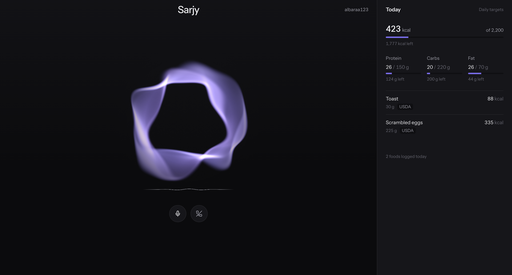
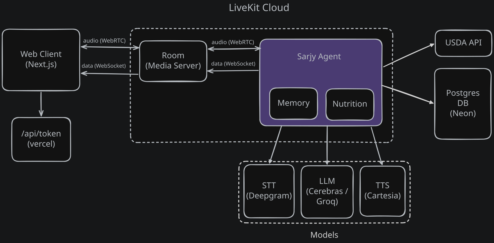

# Sarjy

A voice assistant that remembers you and tracks what you eat, with every number from the USDA.

**Live:** https://sarjy-five.vercel.app/ · **Demo:** https://www.loom.com/share/d23a02610fa44971a5cf4dad72ceb191



## What it does

- Talks by voice in the browser
- Remembers facts about you across sessions
- Answers calorie and macro questions from USDA data
- Logs meals by voice, with a live daily intake panel

## Try it

1. Open the live URL, enter a username and allow the microphone. Your username is who Sarjy remembers, so reuse it next time.
2. Say things like:
   - "My name is Sam, and my favorite color is green."
   - "How much protein is in a chicken breast?"
   - "I had two eggs and a slice of toast for breakfast." → "Yes"
   - "What do I have left today?"
3. Hang up, start again with the same username, and ask "What's my favorite color?"

The first call after a quiet period can take 10 to 20 seconds while the agent wakes up (LiveKit Cloud free plan).

## Why USDA FoodData Central

LLMs confidently make up nutrition facts, and a food log is only useful if its numbers are right. USDA FoodData Central is a free, authoritative source for both generic foods and prepared dishes, so it gives Sarjy a reliable backbone: every number it speaks or saves comes from USDA, and anything USDA lacks is labeled as an estimate.

## Architecture



## Tech stack

| Layer | Choice |
|---|---|
| Voice framework | LiveKit Agents (Python), hosted on LiveKit Cloud |
| Speech-to-text | Deepgram Nova-3 |
| LLM | Qwen 3.8 27B on Cerebras, gpt-oss-120b on Groq as fallback |
| Memory extraction | gpt-oss-20b on Groq |
| Text-to-speech | Cartesia Sonic 3.6 |
| Web | Next.js 16, React 19, Tailwind, LiveKit Components, hosted on Vercel |
| Database | Postgres on Neon |
| External API | USDA FoodData Central |

## More

- [Writeup: deep dive, decisions, testing](docs/writeup.md)
- [Memory and nutrition flows](docs/diagrams/diagrams.md)

## Project structure

```
agent/        LiveKit voice agent (Python)
  sarjy.py      persona and greeting
  memory/       remembers facts across sessions
  nutrition/    USDA lookups, food diary, LLM tools
  tests/
web/          Next.js frontend and token route
docs/         plan and diagrams
```

## Run locally

You need a LiveKit Cloud project, a Postgres database, and API keys for Deepgram, Cerebras, Groq and Cartesia. A USDA key is optional (`DEMO_KEY` allows 30 requests an hour).

**Agent**

```sh
cd agent
cp .env.example .env              # fill in the keys
psql "<your DATABASE_URL>" -f schema.sql
uv sync
uv run python -m livekit.agents download-files
uv run python -m livekit.agents start agent.py --dev
uv run pytest                     # uses the real LLM and database, stubs USDA
```

**Web**

```sh
cd web
cp .env.example .env.local        # same LiveKit credentials as the agent
npm install
npm run dev                       # http://localhost:3000
```
